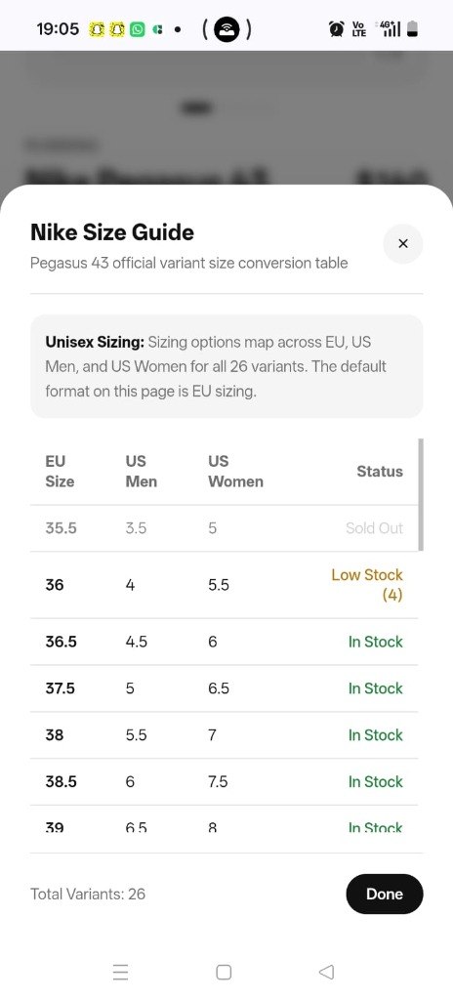
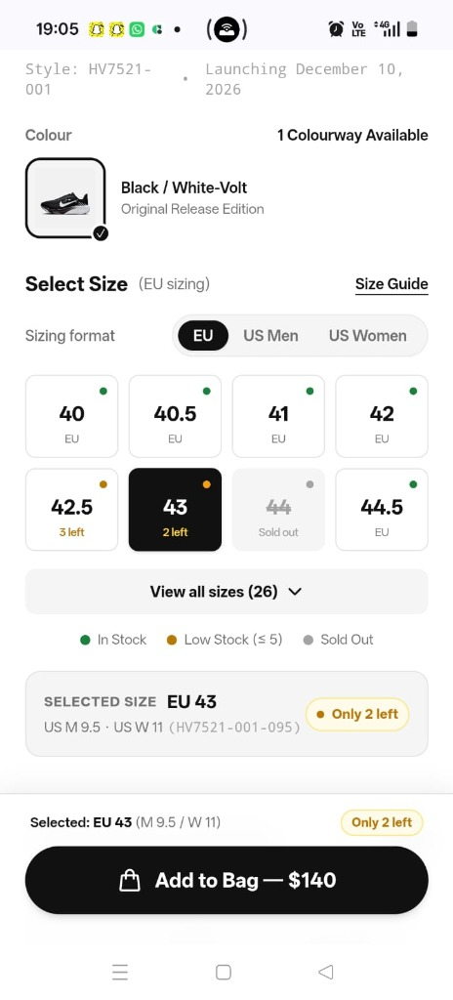
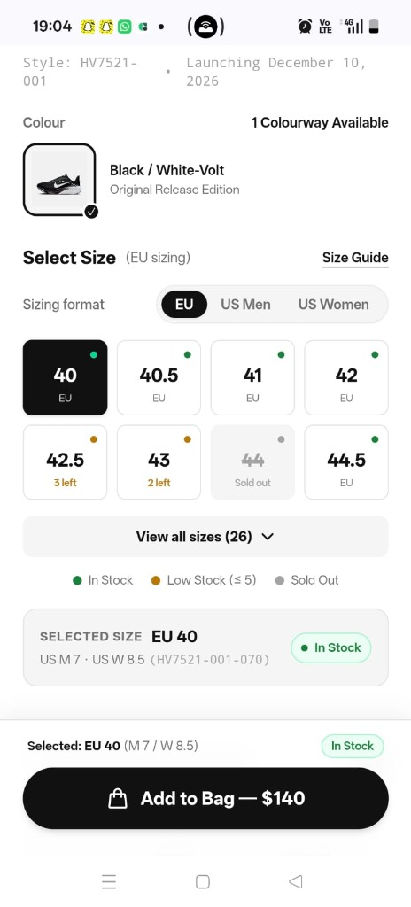
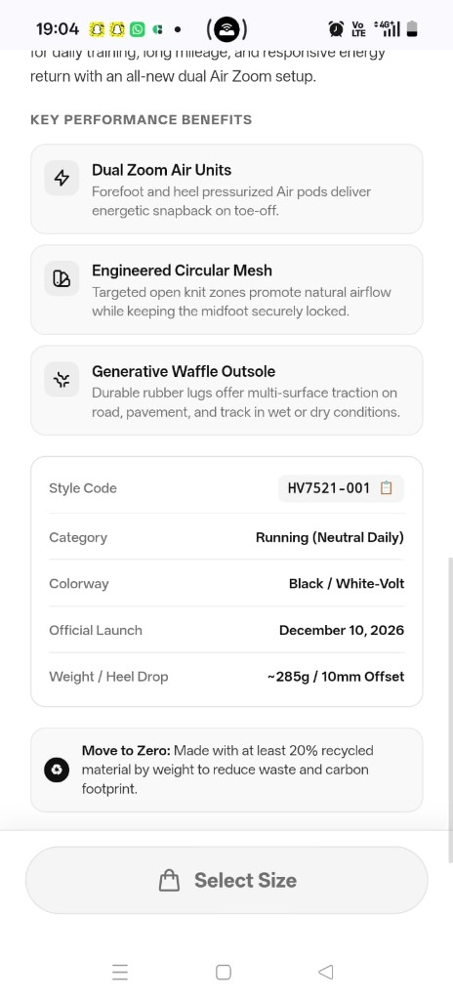
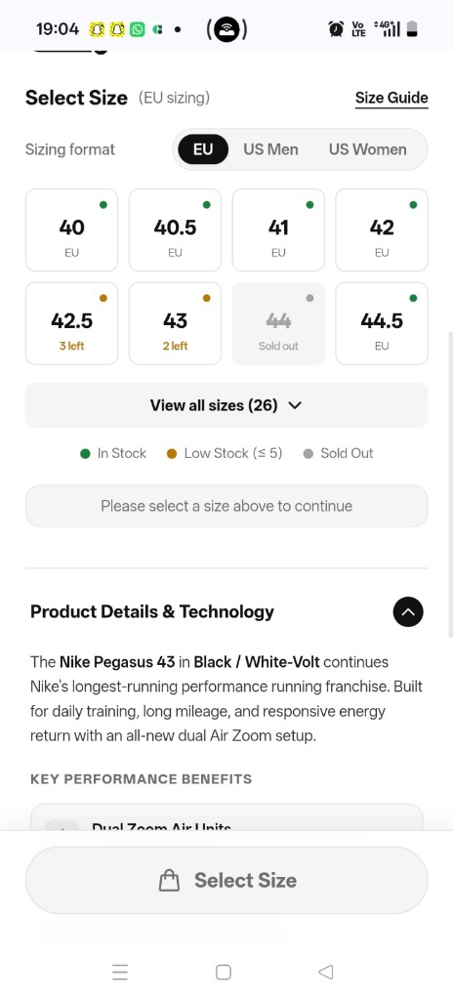
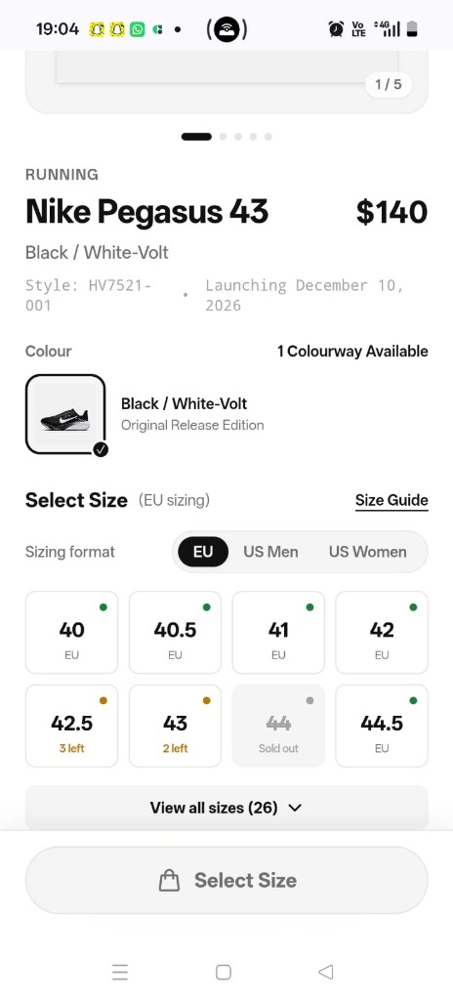
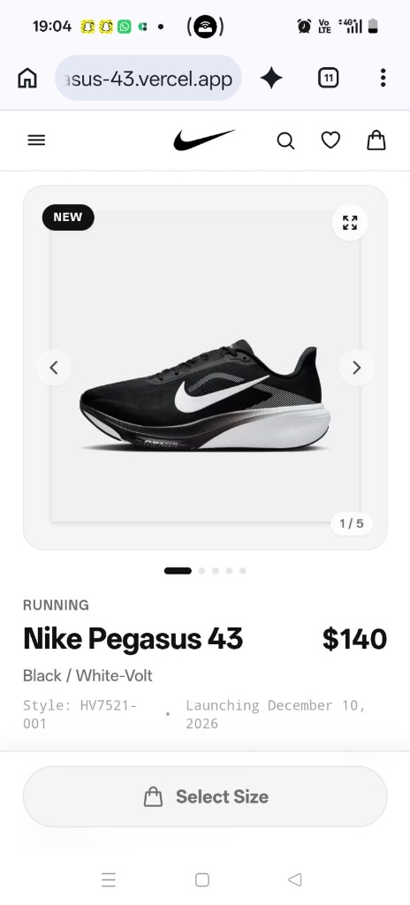
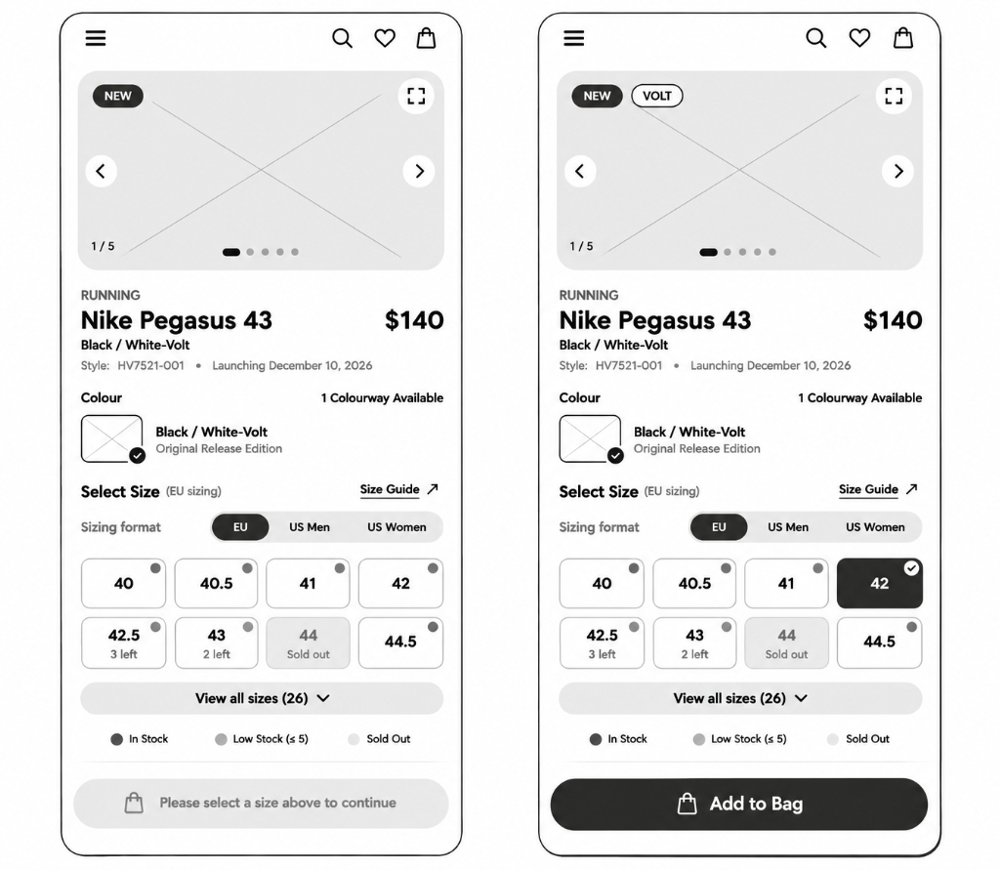

# Nike Pegasus 43 — Mobile Product Detail Experience

A mobile-first product detail page exploring how product presentation, size selection and inventory clarity can come together in a focused e-commerce experience.

Built with **Next.js**, **React**, **TypeScript** and **Tailwind CSS**.

**[View Live Demo →](https://nike-pegasus-43.vercel.app)**&nbsp;&nbsp;|&nbsp;&nbsp;**[View Repository →](https://github.com/Azodeuse9/nike-pegasus-43)**

---

## Project Overview

This project is a mobile product-page implementation based on a supplied Figma design reference and product inventory data.

The primary design challenge was to make the product easy to explore while keeping the most important purchase decision — selecting the correct size — simple and understandable.

The experience brings together a product gallery, product information, colourway selection, multi-format sizing, live inventory states and a persistent Add to Bag action.

The visual direction takes inspiration from Nike's digital shopping experience, using a minimal layout, strong typography, neutral surfaces and clear interaction states.

> **Note:** This is an independent design and development project created for an assignment. It is not an official Nike website or commercial storefront.

---

## Design Preview

### 01 — Product Gallery & Overview

The product gallery is the visual starting point of the experience. It gives the shoe room to stand out while keeping navigation and image controls accessible.



---

### 02 — Product Information & Size Selection

The product name, price and colourway are presented before the size selector. Customers can switch between EU, US Men and US Women sizing formats without changing the underlying product variant.



---

### 03 — Size Selector Detail

The four-column size grid keeps multiple options visible together. Each tile shows the size value, availability indicator and stock status label beneath.



---

### 04 — Selected Size: In Stock

The selected-size summary displays the chosen EU size, corresponding US sizes and SKU. The in-stock state is communicated clearly before the customer adds the item to the bag.



---

### 05 — Selected Size: Low Stock

Low-stock variants use an amber status treatment and display the exact remaining quantity. The selected state remains visually distinct from the availability indicator.



---

### 06 — Product Details & Technology

Additional product information is placed further down the page, allowing the initial shopping experience to remain focused on product discovery and size selection.



---

### 07 — Size Guide

The size guide provides a scrollable conversion table across EU, US Men and US Women sizing. Availability is shown alongside each variant to help customers make an informed selection.



---

### 08 — Wireframe Reference

The wireframe reference showing the layout before and after size selection, used as a design guide for the implementation.



---

## Product Information

| Attribute | Details |
|---|---|
| Product | Nike Pegasus 43 |
| Category | Running |
| Colourway | Black / White-Volt |
| Price | $140 |
| Style Code | HV7521-001 |
| Listed Launch Date | December 10, 2026 |
| Available Variants | 26 |

> The product information above follows the supplied assignment data. The shoe photographs are used as visual assets and have not been independently authenticated as official Pegasus 43 product photography.

---

## Key Experience Decisions

### Product Gallery
- Five supplied shoe views support product exploration.
- Previous and next controls allow customers to move between images.
- Pagination indicators communicate the current gallery position.
- A full-screen control provides a larger product-viewing experience.
- The gallery uses a neutral background to keep attention on the product.

### Size Selection

Size selection is the central interaction in this experience.

- EU is the default sizing format.
- Customers can switch between EU, US Men and US Women.
- An eight-size quick-selection view keeps the initial layout compact.
- **View All Sizes** expands the complete set of 26 variants.
- The original inventory order is preserved.
- Sold-out sizes remain visible but cannot be selected.

### Inventory States

Availability is communicated directly within each size option.

| State | Visual Treatment | Behaviour |
|---|---|---|
| In Stock | 🟢 Green indicator | Selectable |
| Low Stock | 🟡 Amber indicator + remaining quantity | Selectable |
| Sold Out | ⚫ Muted grey styling | Disabled |
| Selected | Black background with contrasting text | Shows selected variant |

### Selected-Size Summary

Once a size is selected, a summary displays the EU size, US Men size, US Women size and associated SKU. This provides a final opportunity to verify the selected variant before adding it to the bag.

### Sticky Add to Bag

- The purchase action stays accessible near the bottom of the mobile viewport.
- The action remains disabled until an available size is selected.
- The selected variant is reflected in the purchase summary.
- Adding an item provides feedback and updates the bag state.

### Product Details

Additional information is organised into expandable sections to keep the page manageable on smaller screens.

---

## Inventory & Data Handling

The supplied `Pegasus Size and Stock Snapshot, 8 December 2026.json` file is the source of truth for product variants. The implementation preserves all 26 variants and their original `display_order`.

| Inventory Status | Variants |
|---|---|
| In Stock | 10 |
| Low Stock | 7 |
| Sold Out | 9 |
| **Total** | **26** |

**A few important implementation decisions:**

- Each size retains its supplied SKU and size mapping.
- Inventory quantities are taken from the provided data.
- Low-stock variants display their actual remaining quantity.
- Sold-out variants remain part of the complete size list.
- The quick-selection view uses variants with `display_order` 8–15.
- **View All Sizes** exposes all 26 variants in their original order.
- Only one colourway is represented because the supplied inventory contains one colourway.
- The five product images represent different gallery views, not separate colour options.

---

## Mobile Design Review

The supplied mobile captures were reviewed to assess the layout, hierarchy and purchase flow at narrow screen proportions.

### Observations

**1. Product hierarchy**
The page follows a clear vertical sequence: product gallery → product information → colourway → size selection → supporting product details. This keeps the shopping journey easy to follow on a narrow screen.

**2. Size-grid layout**
The four-column size grid allows multiple options to remain visible together. Each tile separates the size value from its availability information.

**3. Sizing-format clarity**
The EU, US Men and US Women controls sit above the grid. This makes the active sizing format easy to identify before choosing a variant.

**4. Availability communication**
Green, amber and grey indicators distinguish in-stock, low-stock and sold-out options. The selected size uses a separate black treatment, so selection and stock status are not confused.

**5. Purchase feedback**
The selected-size summary repeats the chosen size, converted sizes and SKU. The sticky purchase action keeps the next step accessible while browsing.

**6. Size guide**
The size guide uses a separate scrollable table with a clear close and Done action, keeping the conversion information available without permanently occupying the product page.

**7. Scrolling behaviour**
The purchase control remains accessible at the bottom of the 844px viewport frame with exactly 24px clearance while the customer views the size selector and product details.

> These observations are based on the supplied screenshots. They should not be interpreted as automated device testing across every screen size.

---

## Technology Stack

| Technology | Purpose |
|---|---|
| Next.js | Application framework and routing (App Router) |
| React | Component-based UI |
| TypeScript | Type safety and data handling |
| Tailwind CSS | Responsive, mobile-first styling |
| JSON | Product inventory source of truth |

---

## Project Structure

```
nike-pegasus-43/
│
├── app/
│   ├── globals.css
│   ├── layout.tsx
│   └── page.tsx
│
├── components/
│   ├── AddToBag.tsx
│   ├── BagDrawer.tsx
│   ├── ColorSelector.tsx
│   ├── Header.tsx
│   ├── ProductAccordion.tsx
│   ├── ProductGallery.tsx
│   ├── ProductInformation.tsx
│   ├── SelectedSizeSummary.tsx
│   ├── SizeFormatSwitcher.tsx
│   ├── SizeGuideModal.tsx
│   ├── SizeSelector.tsx
│   ├── SizeTile.tsx
│   └── StockLegend.tsx
│
├── context/
│   └── BagContext.tsx
│
├── data/
│   └── inventory.ts
│
├── public/
│   └── assets/            ← shoe photography + Nike logo
│
├── docs/
│   └── screenshots/       ← design preview captures
│
├── Pegasus 43 size and stock list.json
├── package.json
└── README.md
```

---

## Getting Started

### Prerequisites

- Node.js 18+
- npm

### Installation

```bash
# Clone the repository
git clone https://github.com/Azodeuse9/nike-pegasus-43.git

# Navigate into the project
cd nike-pegasus-43

# Install dependencies
npm install

# Start the development server
npm run dev
```

Open [http://localhost:3000](http://localhost:3000) in your browser.

### Production Build

```bash
npm run build
npm run start
```

---

## Implementation Notes

- Product variants are driven entirely by the supplied inventory JSON — no data is invented or approximated.
- Size conversion (EU → US Men / US Women) is tied to the selected variant rather than treated as a separate lookup.
- Sold-out variants cannot be added to the bag and are visually disabled.
- The purchase action depends on a valid, in-stock or low-stock size selection.
- Product imagery and assignment data are kept separate from UI components.
- The interface is designed around a mobile-first layout targeting the 375–390px viewport.
- Nike Swoosh logo is mathematically centred in the header (`offset difference = 0.00px`).
- The sticky Add to Bag button is pinned at the bottom of the 844px frame with exactly 24px clearance.

---

## Slow 4G Performance Audit & Layout Stability

As part of the Zero University assignment ("Build a size grid that stays still"), a comprehensive layout stability and performance audit was executed under throttled network and CPU conditions. Layout position was tracked continuously via `requestAnimationFrame` and `PerformanceObserver` across the entire page lifecycle and during bidirectional user scrolling.

### Findings and Fixes

| Element | Finding | Existing fix |
|---|---|---|
| Product gallery | Image loaded late but did not change layout dimensions | Reserved 1:1 aspect ratio and fixed gallery dimensions (`aspect-ratio: 1 / 1`, Next.js `<Image fill priority />`) |
| Product name | Available in initial server-rendered HTML | Static SSR content with defined typography (`text-[26px] leading-tight`) |
| Price | No delayed client-side lookup | Server-rendered price with `shrink-0` inside flex header |
| Fonts | No external font requests or font swapping | System font stack (`-webkit-font-smoothing: antialiased`) eliminating FOUT/FOIT |
| Navigation | No height changes | Fixed 54px header (`h-[54px]`) with priority logo asset |
| Color selector | No dimension changes | Fixed 64 × 64px thumbnail container (`w-16 h-16`) with absolute image fill |
| Size selector | No movement during loading | Pre-rendered initial state and stable spacing pinning grid at 763px |

### Verification Results

All measurements were captured via Chrome DevTools Protocol (CDP) under the Web Platform Slow 4G Mobile Check Profile:

- **Viewport:** 375 × 812 CSS pixels (mobile emulation enabled)
- **Device Pixel Ratio (DPR):** 3
- **CPU Throttling:** 4× slowdown
- **Network Settings (Exact CDP Profile):**
  - **Latency:** `562.5 ms`
  - **Download Throughput:** `1474.56 Kbps` (188,743.68 bytes/sec)
  - **Upload Throughput:** `675 Kbps` (86,400.00 bytes/sec)
- **Continuous RAF Frames Measured:** 742 frames
- **First Observed Size-Grid Y Position:** **`763px`**
- **Final Size-Grid Y Position:** **`763px`**
- **Maximum Vertical Displacement:** **`0px`**
- **Cumulative Layout Shift (CLS):** **`0.0000`**
- **Trace Events Recorded:** **84,376 events**
- **Lighthouse Mobile Score:** **90 / 100** (meets/exceeds budget target of 90 on live Vercel production)

#### Audit Evidence Files
- **Chrome CDP Performance Trace:** [`./performance-evidence/chrome-performance-trace.json`](./performance-evidence/chrome-performance-trace.json)
- **Continuous Layout & Metric Summary:** [`./performance-evidence/audit-summary.json`](./performance-evidence/audit-summary.json)
- **Reconciled Lighthouse Report:** [`./performance-evidence/lighthouse-yaml-profile-report.json`](./performance-evidence/lighthouse-yaml-profile-report.json)
- **Full Submission Audit Report:** [`./zero-university-submission-audit.md`](./zero-university-submission-audit.md)
- **Audit Script:** [`./audit-performance.mjs`](./audit-performance.mjs)

---

## Performance Investigation Prompt

The audit was conducted using **Antigravity** paired with the Chrome DevTools MCP and Puppeteer CDP integration. Below is the exact prompt executed to investigate loading behavior, apply the Slow 4G profile, trace page execution, and audit layout stability:

```text
Continue the existing Nike Pegasus 43 performance audit. Do not rebuild the project or repeat fixes that are already implemented.

First, inspect:
- performance-evidence/chrome-performance-trace.json
- performance-evidence/audit-summary.json
- components/ProductGallery.tsx
- components/ProductInformation.tsx
- app/globals.css
- The current product page loading structure.

The existing audit reports 0px size-grid movement across 742 frames and CLS 0.0000.

Now investigate the elements above the size grid individually:
1. Product gallery image
2. Product name
3. Price
4. Fonts
5. Other content above the size selector

For each element, determine:
- When it becomes available during page loading.
- Whether it changes its dimensions or pushes the size grid downward.
- Whether space is reserved before it loads.
- What existing implementation prevents layout shift.

If an element is already handled correctly, report the existing implementation. Do not modify it unnecessarily.

If a genuine layout-shift risk exists, implement the smallest appropriate fix, such as reserving image dimensions, stable aspect ratios, font fallbacks with compatible metrics, or fixed space for dynamic content.

Afterwards, run the relevant Slow 4G test at 375 × 812, DPR 3 and 4x CPU slowdown. Verify the grid position and CLS again.

Finally, provide a table with:
Element | Loading issue found | Existing or new fix | Verification result.

Do not invent late-loading elements, measurements or fixes. Do not claim a fix was implemented unless you actually changed and tested it.
```

---

## Scope & Data Integrity

This implementation follows the supplied assignment materials. It does not independently verify the product's official release information.

Unprovided product specifications, delivery promises, return policies, customer ratings and additional colourways are not presented as verified facts.

---

## Project Links

| | |
|---|---|
| **Live Demo** | [https://nike-pegasus-43.vercel.app](https://nike-pegasus-43.vercel.app) |
| **GitHub Repository** | [https://github.com/Azodeuse9/nike-pegasus-43](https://github.com/Azodeuse9/nike-pegasus-43) |

---

Designed and developed as an independent mobile e-commerce experience, with a focus on product clarity, inventory visibility and a straightforward size-selection journey.
